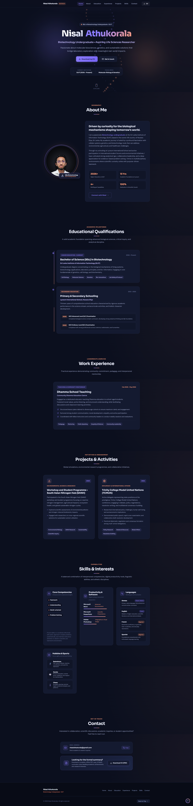

# Nisal Athukorala — Personal Portfolio Website

[](https://pages.github.com/)
[](https://developer.mozilla.org/)
[](#design-system)
[](#accessibility--performance)

A modern, high-performance, single-page dark-theme personal portfolio website built for **Nisal Athukorala**, a Biotechnology undergraduate at the **Sri Lanka Institute of Information Technology (SLIIT)**.

Crafted with pure semantic **HTML5**, **CSS3**, and **vanilla JavaScript** — no external frameworks, no libraries, and zero build tool overhead. Completely ready for instant deployment on **GitHub Pages**.

---

## 📸 Portfolio Preview

<!-- Replace the placeholder below with a screenshot of your live website -->


> _A screenshot of the live website showing the hero section with animated DNA double helix, word-by-word slide entrance, and midnight indigo cards._

---

## ✨ Features & Highlights

- **Midnight Indigo Design Language**:
  - Background `#0b0f1e`, raised cards `#141a30`, borders `#232b4a`, primary text `#eceffd`, and muted text `#9aa3c7`.
  - Signature accents: **Violet (`#8b7cff`)** and **Peach (`#ff9d7a`)**.
  - Premium typography pairing: **Sora** for modern titles and **DM Sans** for legible body reading.
- **Biotechnology Animated DNA Double-Helix Across All Sections**:
  - Full-page continuous HTML5 `<canvas>` animation mathematically modeling a rotating 3D double helix with connecting nucleotide base-pair rungs and glowing nodes across all sections (Hero, About, Education, Experience, Projects, Skills, Contact).
  - Dynamically responds to user scroll depth and velocity, smoothly wrapping from top to bottom.
  - Automatically scales to device pixel ratio for crisp rendering on Retina and 4K displays.
- **Word-by-Word Hero Entrance**:
  - Smooth slide-up staggered typography entrance for the owner's name.
- **Ordered Sticky Navigation & Scroll Spy**:
  - Glassmorphic top navigation with active section tracking via `IntersectionObserver`.
  - Smooth scrolling with offset compensation.
- **Fully Responsive (Down to 360px)**:
  - Accessible mobile hamburger navigation drawer with keyboard support (`Escape` to close, outside-click detection).
- **Interactive Capabilities**:
  - One-click copy-to-clipboard for Email with live toast notifications.
  - Direct CV download button linking to the offline PDF file.
  - "Back to Top" smooth return button.
- **Accessibility & Motion Consideration**:
  - Semantic HTML5 landmarks (`<header>`, `<nav>`, `<main>`, `<section>`, `<article>`, `<footer>`).
  - Strict line-length limits (`max-width: 65ch`) for optimal cognitive readability.
  - Full support for `prefers-reduced-motion: reduce` (disables canvas loops and transitions).
  - High color contrast meeting WCAG AA standards.

---

## 🗂️ Project Structure

```text
nisal-malli/
├── index.html                   # Semantic HTML5 single-page structure
├── style.css                    # Design system, CSS tokens, responsive styles
├── script.js                    # Canvas DNA animation, scroll spy, interactive features
├── README.md                    # Project documentation & deployment guide
└── assets/
    ├── photo.png                # Circular profile portrait photograph of Nisal Athukorala
    ├── photo.jpg                # Portrait photograph backup
    ├── Nisal_Athukorala_CV.pdf  # Downloadable Curriculum Vitae (PDF)
    └── screenshot.png           # (Optional) Portfolio preview screenshot
```

---

## 🚀 How to Host on GitHub Pages (Step-by-Step)

Deploying this portfolio to the web for free with **GitHub Pages** takes less than 3 minutes:

### Step 1: Create a GitHub Repository
1. Log into your account at [GitHub.com](https://github.com/).
2. Click the **`+`** icon in the top-right corner and select **New repository**.
3. Name your repository (e.g. `portfolio` or `nisal-athukorala`).
4. Set the visibility to **Public**.
5. Do not initialize with a README (this project already has one).
6. Click **Create repository**.

### Step 2: Upload or Push the Code
#### Option A: Using Git CLI in your terminal:
```bash
# Navigate to your project folder
cd "path/to/nial malli"

# Initialize git
git init
git add .
git commit -m "Initial commit: Nisal Athukorala portfolio"

# Rename branch to main
git branch -M main

# Link to your newly created GitHub repository
git remote add origin https://github.com/<your-username>/<your-repo-name>.git

# Push your code
git push -u origin main
```

#### Option B: Using GitHub Web Interface:
1. In your empty repository page, click **uploading an existing file**.
2. Drag and drop `index.html`, `style.css`, `script.js`, `README.md`, and the `assets/` folder.
3. Click **Commit changes**.

### Step 3: Enable GitHub Pages
1. Go to your repository on GitHub and click on **Settings** (top tab).
2. In the left navigation sidebar, select **Pages** (under the "Code and automation" section).
3. Under **Build and deployment**:
   - **Source**: Select `Deploy from a branch`.
   - **Branch**: Select `main` (or `master`) and folder `/ (root)`.
4. Click **Save**.
5. Wait 30–60 seconds. Refresh the page to see your live URL:
   ```text
   https://<your-username>.github.io/<your-repo-name>/
   ```

---

## 📋 Content & Section Details

1. **Hero**: Name (*Nisal Athukorala*), title (*Biotechnology Undergraduate*), one-line statement, quick action buttons (*Download my CV* and *Get in touch*).
2. **About Me**: Narrative overview, undergraduate focus, and portrait photo (`assets/photo.jpg`).
3. **Educational Qualifications**:
   - **Higher Education**: Sri Lanka Institute of Information Technology (SLIIT) — BSc in Biotechnology (2026 – Present).
   - **Secondary Education**: Lyceum International School, Nuwara Eliya (2012 – 2025) — GCE A/L (2025) & GCE O/L (2022).
4. **Work Experience**: Dhamma School Teaching (Feb 2026 – May 2026).
5. **Projects and Activities**:
   - Trinity College Model United Nations (TCMUN, 2024).
   - Workshop and Student Programme, South Asian Nitrogen Hub (SANH, 2025).
6. **Skills and Interests**:
   - **Core Competencies**: Teamwork, Understanding, Detail-oriented, Problem solving.
   - **Software & Productivity**: Microsoft Word, Microsoft PowerPoint, Canva.
   - **Languages**: Sinhala (Fluent), English (Fluent), French (Beginner), Spanish (Beginner).
   - **Hobbies & Sports**: Badminton, Karate, Chess.
7. **Contact**: Direct email and direct offline CV download.

---

## 🎨 Design System

| Element | Value | Description |
| :--- | :--- | :--- |
| **Dark Background** | `#0b0f1e` | Midnight indigo base canvas |
| **Raised Surface** | `#141a30` | Cards, timeline, and form containers |
| **Elevated Surface** | `#1b2342` | Highlights, hover surfaces, and floating badges |
| **Border Color** | `#232b4a` | Thin, crisp separation without heavy shadows |
| **Primary Accent** | `#8b7cff` | Electric violet for interactive elements |
| **Secondary Accent** | `#ff9d7a` | Warm peach for status indicators & tags |
| **Headings Font** | `Sora`, sans-serif | Geometric & modern heading typography |
| **Body Font** | `DM Sans`, sans-serif | Clean, highly legible sans-serif for reading |

---

## 📄 License & Attribution

Designed and developed for **Nisal Athukorala**. All rights reserved &copy; 2026.
Free for personal portfolio use and GitHub Pages hosting.
